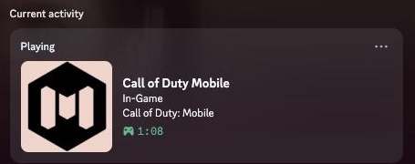
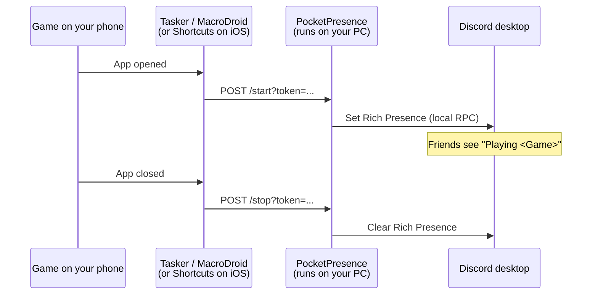

# PocketPresence

Discord Rich Presence ("Playing X") for any mobile game that doesn't natively
support it — Call of Duty: Mobile is the motivating example throughout this
README, but nothing in the code is CODM-specific. Point PocketPresence at any
Discord Application and any game name, and it works the same way.

<p align="center">
  
  <br>
  <em>Real output — CODM opened on a phone with no native Discord integration, no manual toggling.</em>
</p>

## Why this exists

Discord Rich Presence can only be *set* through a local connection to the
Discord **desktop** app — that's a platform limitation, not a bug. Games that
show up on Discord natively (Roblox, most PC titles) do so because the game's
own developer built Discord's SDK into their client, which runs alongside
Discord desktop on the same machine. Mobile-only games with no such
integration have no equivalent path — and no third party can add one without
patching the game client itself, which this project will never do.

**What PocketPresence actually does:** runs a small bridge on a PC that has
Discord desktop open. Your phone's own automation app (Tasker/MacroDroid on
Android, Shortcuts on iOS — no separate app needed there) tells the bridge
"the game just opened" or "just closed," and the bridge sets or clears your
Discord status accordingly. To everyone else on Discord, it looks the same as
native support.

## How it works



The phone never talks to Discord directly — it only tells your own bridge
"open" or "closed." The bridge is the only thing that ever touches Discord's
local RPC connection, which is why it has to run on a PC with Discord desktop
open.

## Requirements

- A computer that can stay on with **Discord desktop running** — it doesn't
  need to be actively in use, just on.
- [Node.js](https://nodejs.org) 20 or newer on that computer.
- A phone automation app: [Tasker](https://play.google.com/store/apps/details?id=net.dinglisch.android.taskerm)
  or [MacroDroid](https://play.google.com/store/apps/details?id=com.arlosoft.macrodroid)
  on Android, or the built-in **Shortcuts** app on iOS.
- Optional but recommended: [Tailscale](https://tailscale.com) if you want
  this to work from anywhere, not just your home WiFi (see
  `docs/tailscale.md`).

## Quickstart

```bash
git clone https://github.com/krishnaakshath/pocket-presence.git
cd pocket-presence
npm install
node bin/setup.js
```

The wizard will:

1. Ask for your game's name and your [Discord Application ID](https://discord.com/developers/applications)
   (create a free Discord Application, name it exactly what you want to show
   up in your status). While you're in the developer portal, upload a game
   icon under **Rich Presence → Art Assets** and give it the icon key you
   enter in the wizard — without one, Discord shows a generic placeholder
   instead of your game's actual icon.
2. Generate a random shared secret so only your own phone can trigger it.
3. Live-test the Discord connection right there — you'll know immediately if
   something's wrong, instead of finding out later.
4. Offer to install auto-start for your OS (macOS LaunchAgent, Windows
   Scheduled Task, or Linux systemd `--user` unit) so the bridge comes back
   up automatically after a reboot.
5. Print the exact URLs and token to paste into your phone automation app.

Then configure your phone:
- Android: `docs/android-tasker.md`
- iOS: `docs/ios-shortcuts.md`
- Reaching the bridge when you're not on the same WiFi (e.g. on cellular
  data): `docs/tailscale.md`

## Checking it's actually working

Before wiring up your phone, confirm the bridge itself is connected to
Discord:

```bash
curl "http://localhost:<PORT>/health?token=<SHARED_SECRET>"
```

Returns `200 ready` once Discord desktop is open and connected, or
`503 not ready` if Discord isn't reachable yet — useful for debugging without
having to open the game every time, and safe to hit repeatedly since it never
changes your presence.

Once that's green, you can manually fire `/start` and `/stop` the same way
(see `config.example.env` for your port and secret) before ever touching
Tasker/MacroDroid/Shortcuts — if a manual `curl` to `/start` shows up on
Discord, the bridge side is fully proven and any remaining issue is on the
phone-automation side.

## Platform support

| OS | Auto-start mechanism | Status |
|---|---|---|
| macOS | LaunchAgent | Generates the same LaunchAgent configuration verified end-to-end on real hardware |
| Windows | Scheduled Task (`schtasks.exe`) | Implemented against Microsoft's documented syntax; **not yet verified on real Windows hardware** |
| Linux | systemd `--user` unit | Implemented against systemd's documented mechanism; **not yet verified on real Linux hardware** |

If the Windows or Linux installer doesn't work on your machine, please open
an issue with the exact error — that's the fastest way to close the gap.

## Manual run (without auto-start)

```bash
cp config.example.env .env   # then fill in the values, or just use the wizard
npm start
```

## What this project deliberately doesn't do

- No tracking multiple games from one running instance — run a second copy
  on a second port if you need that.
- No cloud/headless-Discord hosting option — this is meant to run on a PC
  you already have, on, with Discord open.
- No ADB-based "just works, no extra app" Android detection — it was
  seriously considered, but couldn't be verified to keep working once you
  leave your home WiFi and switch to cellular data, which was a hard
  requirement. Webhook-based detection was chosen instead because it's
  verified to work regardless of network.
- No patching or reverse-engineering of any game client to add native
  Discord SDK support — that's a different (and much harder, ToS-risky)
  problem than this project takes on.

## License

MIT — see `LICENSE`.
