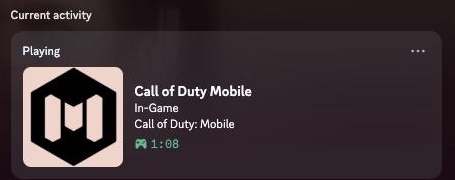

# Proposal: Native Discord Rich Presence Support for Call of Duty: Mobile

**Author:** krishnaakshath
**Date:** 2026-09-12
**Status:** Draft, ready to submit
**Supporting evidence:** [PocketPresence](https://github.com/krishnaakshath/pocket-presence) — a working, open-source proof-of-concept

---

## The ask, in one sentence

Add Discord Rich Presence support to Call of Duty: Mobile using Discord's
official Game SDK, so players' "Playing Call of Duty: Mobile" status appears
automatically on Discord — the same way it already does for hundreds of PC
titles — with no third-party tooling required.

## The problem

Call of Duty: Mobile has no native Discord integration. Players who want
friends to see they're playing currently have no option, even though:

- Discord Rich Presence is a mature, well-documented, free integration path
  (Discord's Game SDK / Social SDK) already used by a huge number of games.
- CODM has an active, Activision-adopted Discord community
  (`discord.gg/codmobile`) — the exact audience this feature would serve is
  already gathered on the platform it would integrate with.
- Player demand for this specific feature is real and documented (a support
  thread on Discord's own community forums explicitly requests CODM Rich
  Presence support).

## Proof it's technically straightforward and worth building

Rather than just ask for this in the abstract, I built a working
demonstration: **[PocketPresence](https://github.com/krishnaakshath/pocket-presence)**,
a small open-source bridge that already delivers the player-facing result —
automatic "Playing Call of Duty: Mobile" Discord status, no manual
toggling — using a phone-automation trigger and Discord's existing local RPC
connection.

  

This is real, running output — not a mockup. It proves two things:

1. **Players want this and will build for it themselves** when there's no
   official path — that's a signal worth acting on, not ignoring.
2. **The player-facing result is genuinely simple** — a title, an elapsed
   timer, an icon. This isn't a request for something exotic; it's asking
   for the same baseline experience already standard across PC gaming.

## Why a third-party bridge is a poor substitute for native support

PocketPresence works, but every one of its limitations disappears the
moment this is built into the game client instead of bolted on externally:

| Limitation of the third-party bridge | Solved automatically by native SDK integration |
|---|---|
| Requires a separate PC running 24/7 with Discord desktop open | Runs directly from the game client — no separate always-on machine needed |
| Requires manual phone-automation setup (Tasker/MacroDroid/Shortcuts) | Zero player setup — works the moment both apps are installed |
| Can only detect "app open" / "app closed" — no match type, mode, or score | Native integration can expose actual game state: match type (Multiplayer/Ranked/Battle Royale), score, party size, matchmaking status |
| A community workaround, not an official, supported feature | An official, maintained, Activision-branded feature |

## What implementation actually involves

Discord's [Game SDK](https://discord.com/developers/docs/developer-tools/game-sdk)
(now folded into the broader [Social SDK](https://discord.com/developers/docs/discord-social-sdk/overview))
is free, well-documented, and designed for exactly this: exposing rich,
structured presence data (not just "open/closed," unlike a third-party
bridge) directly from the game client on both Android and iOS. Since CODM
already has an Activision-registered Discord presence (the community
server), the account/branding setup that normally takes the most time is
already in place.

## Submission

This proposal is submitted through the following channels, in order of
likely reach:

1. **CODM's official Discord community** (`discord.gg/codmobile`) — posted
   for visibility with the community team and other players, since this is
   the audience and channel Activision already actively manages for CODM.
2. **Activision Support feedback form**
   (`support.activision.com/feedback-and-bug-report`, Call of Duty: Mobile)
   — filed as a formal feature request with this document linked.
3. **Discord's own developer/business contact form**
   (`discord.com/developers/contact-us`) — submitted noting Discord's own
   interest in seeing more mobile titles adopt Social SDK integration.

## Expectations, honestly

This is a long-shot outreach effort, not a submission with a guaranteed or
even likely response — there is no dedicated feature-suggestion channel at
Activision or TiMi Studio (CODM's actual developer), and no known precedent
of a fan-built bridge leading to native adoption in any game. It's worth
doing anyway: the cost is low, the evidence is real and freely reusable by
anyone who wants to make the same case, and if it never gets a reply, the
open-source bridge still solves the problem for anyone willing to set it up
themselves.
